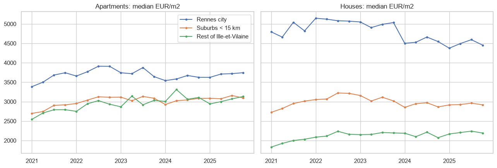
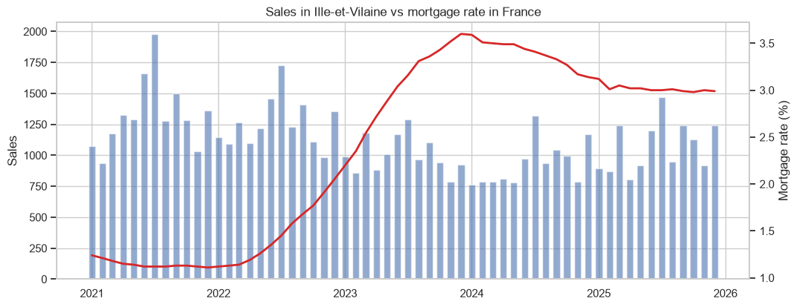

# Housing market in Rennes and Ille-et-Vilaine

What happened with prices and sales when French mortgage rates went from 1% to 3.6%? I use every property sale of the département 35 (2021-2025) and a hedonic regression.

## Data
DVF geolocalised (data.gouv.fr) and the ECB rate of new house purchase loans in France.

## What I did
- Cleaning: only sales of one dwelling, outliers of price per m2, distance to the town hall of Rennes
- Prices and number of sales by zone (Rennes, suburbs, rest of the département)
- Regression of the change in sales on the change in mortgage rates
- Hedonic model: log(price) with surface, rooms, type, distance and year

## Main results
- Sales fell 30% between 2021 and 2024 (15.898 to 11.169) while the median price of apartments in Rennes almost did not move (3.573 to 3.706 EUR/m2 in 2025).
- +1 point of mortgage rate goes with around 17% less sales.
- The same dwelling costs 12% less at 3-6 km from the centre and almost half at 25-40 km.




## How to run

```
pip install -r requirements.txt
jupyter notebook rennes_housing_dvf.ipynb
```

---
Alejandro Lezcano Osorio | Universidad EIA (Colombia) and Rennes School of Business (France)
